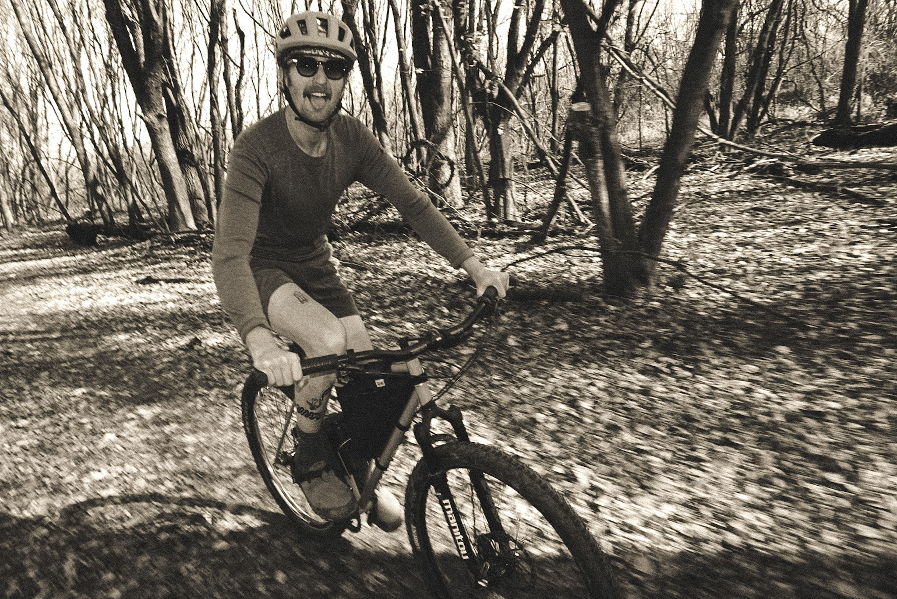
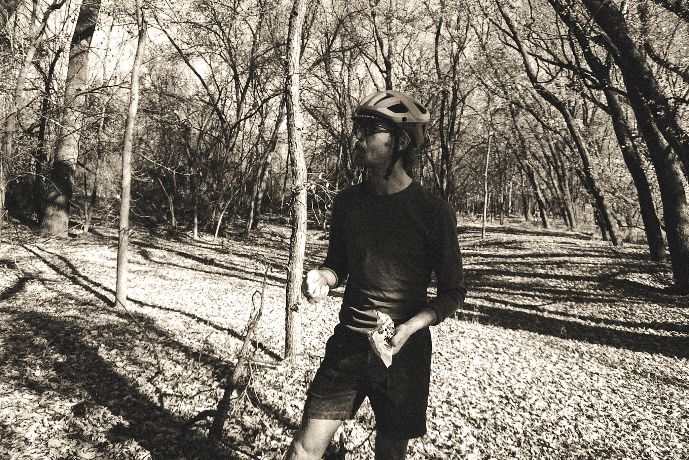

<figure>
  
  <figcaption>one of the classic river bottom views.</figcaption>
</figure>

<figure>
  
  <figcaption>Geir (left) and Alex (right).</figcaption>
</figure>

<figure>
  
  <figcaption>through the single track.</figcaption>
</figure>

<figure>
  
  <figcaption>first water and snack stop.</figcaption>
</figure>

<figure>
  
  <figcaption>fresh fruit!</figcaption>
</figure>

<figure>
  
  <figcaption>creek crossing.</figcaption>
</figure>

<figure>
  
  <figcaption>it was Geir's first ride in the river bottoms.</figcaption>
</figure>

<figure>
  
  <figcaption>a look back into the woods.</figcaption>
</figure>

<figure>
  
  <figcaption>taking a moment before rolling on.</figcaption>
</figure>

<figure>
  
  <figcaption>finally at Taqueria El Patrón.</figcaption>
</figure>

<figure>
  
  <figcaption>did i mention it was muddy?</figcaption>
</figure>

i won’t forget this ride. it was everything i wanted.
