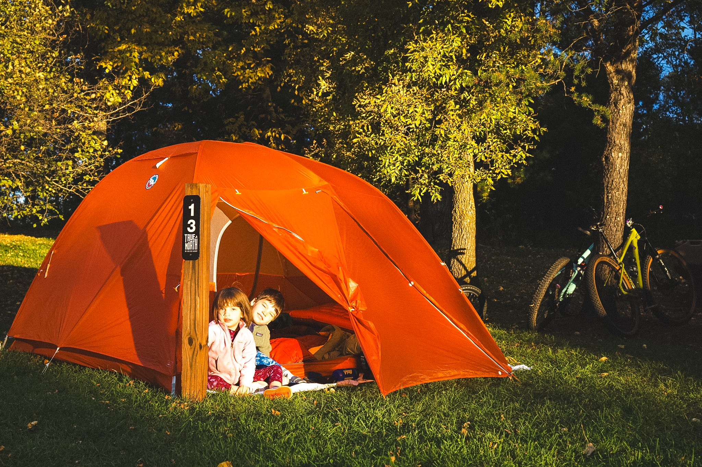
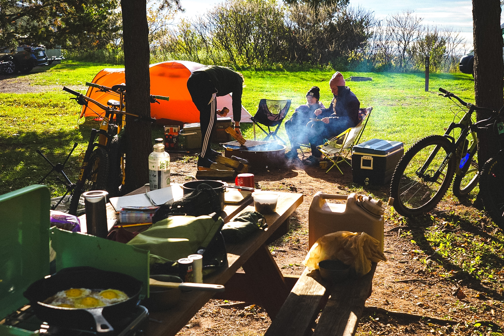
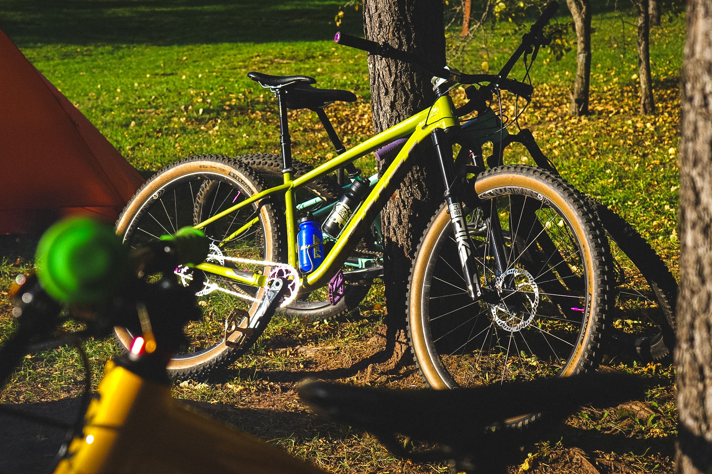
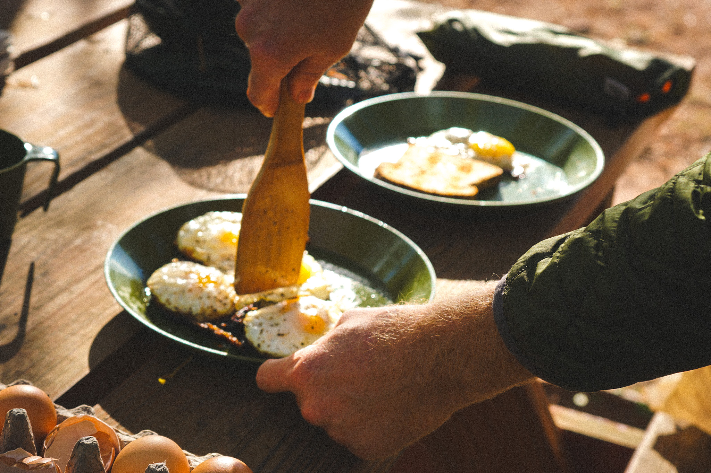
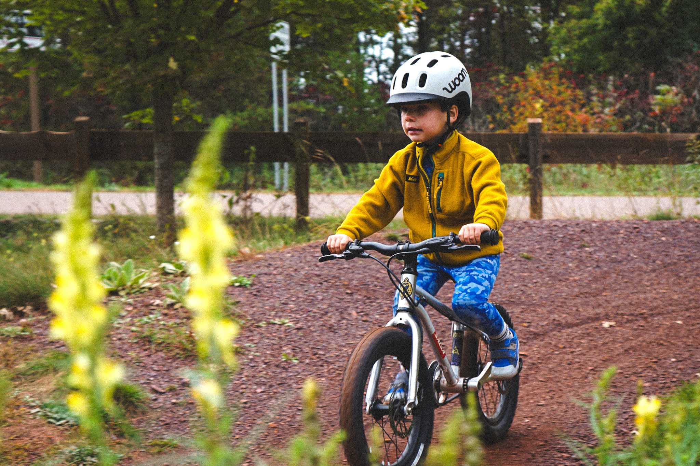
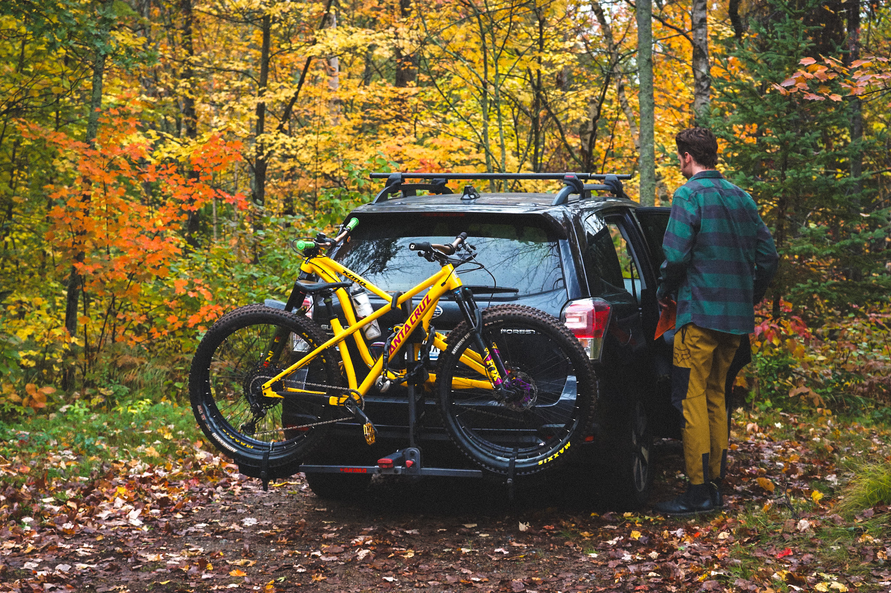

<figure>
  
  <figcaption>settling into camp beneath the fall leaves.</figcaption>
</figure>

<figure>
  
  <figcaption>a slow morning around the campfire.</figcaption>
</figure>

<figure>
  
  <figcaption>the Timberjack looking right at home.</figcaption>
</figure>

<figure>
  
  <figcaption>eggs loading...</figcaption>
</figure>

<figure>
  
  <figcaption>Max's second time doing his own red dirt shredding.</figcaption>
</figure>

<figure>
  
  <figcaption>peak fall colors.</figcaption>
</figure>

again, Cuyuna delivers. good times with great friends.
