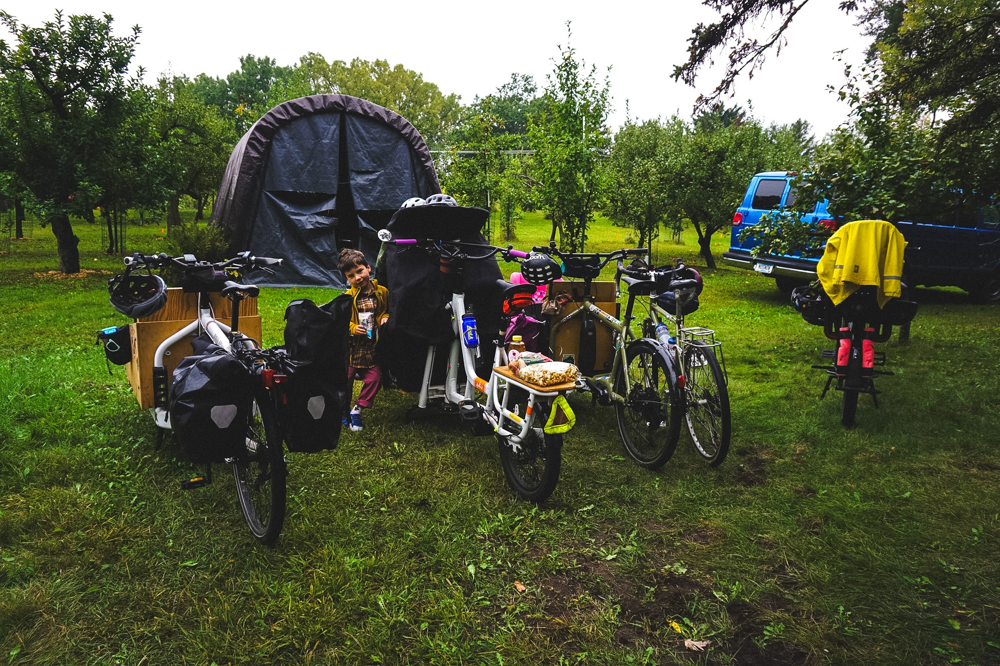
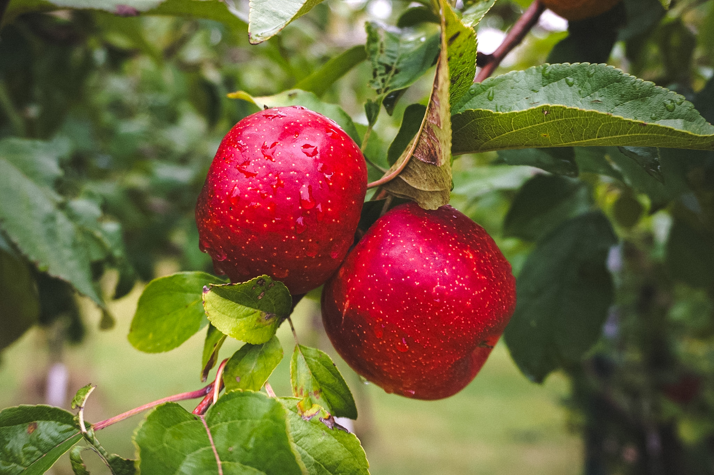
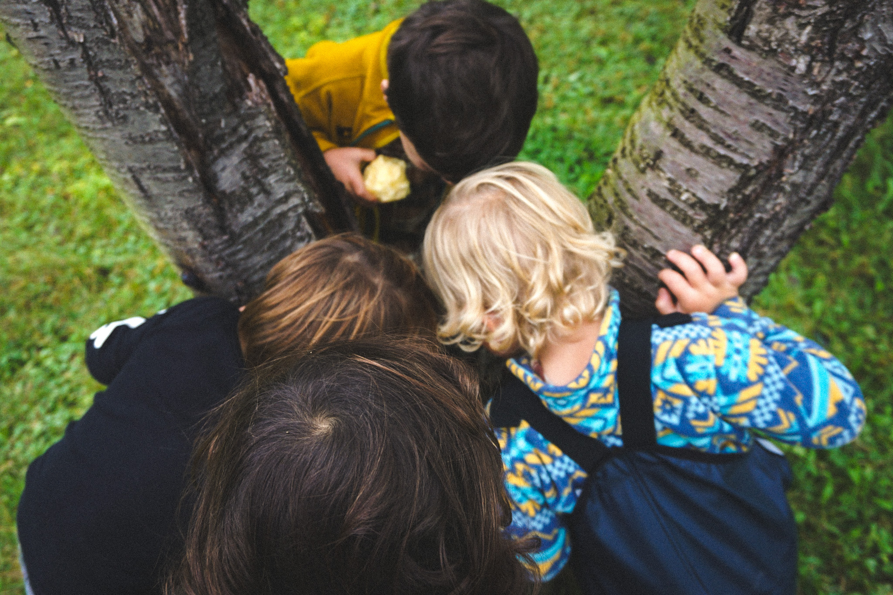
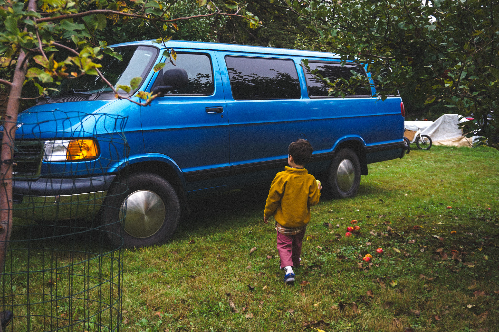
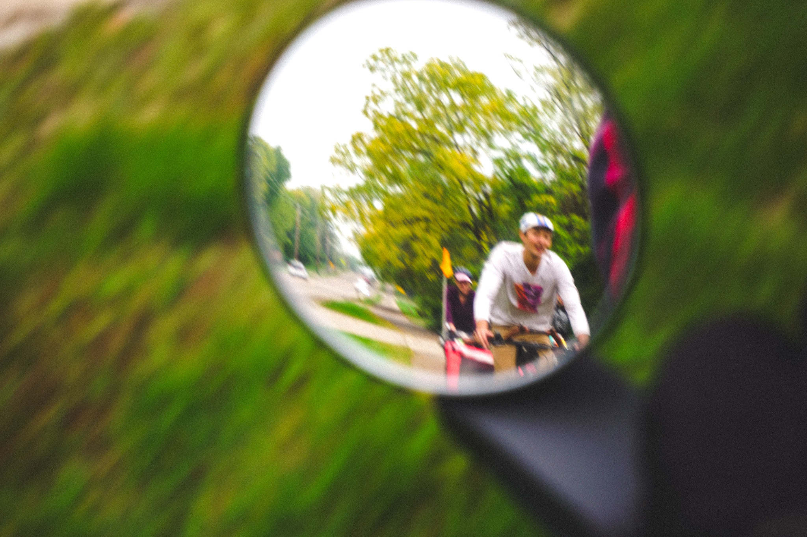
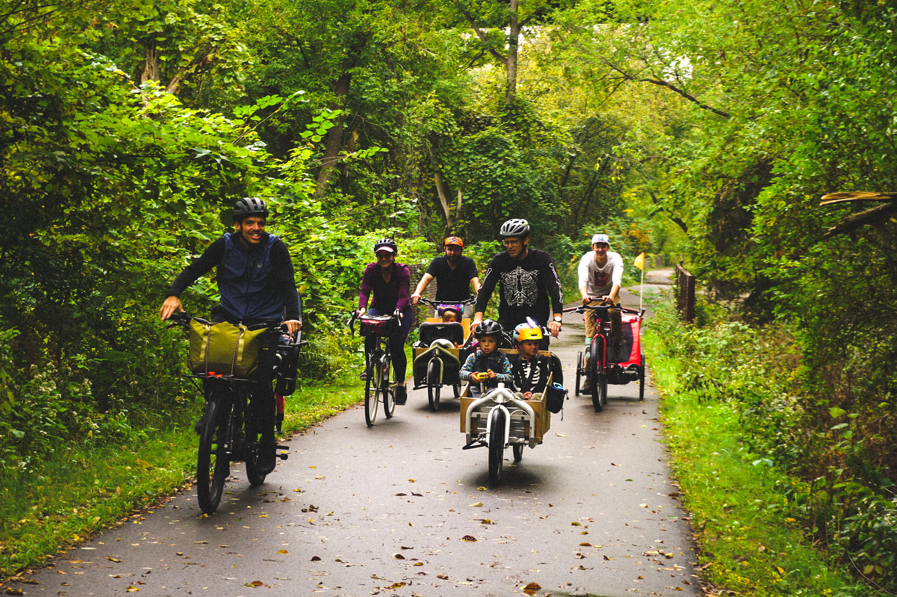

<figure>
  
  <figcaption>the bikes gathered at Juddy's orchard hill.</figcaption>
</figure>

<figure>
  
  <figcaption>apples holding drops.</figcaption>
</figure>

<figure>
  
  <figcaption>a small meeting of the head of hairs.</figcaption>
</figure>

<figure>
  
  <figcaption>this van is my personal favorite token.</figcaption>
</figure>

<figure>
  
  <figcaption>objects in mirror are closer than they appear.</figcaption>
</figure>

<figure>
  
  <figcaption>the Minneapolis Cargo Bike Dads on the move.</figcaption>
</figure>

i’m grateful for this crew.
